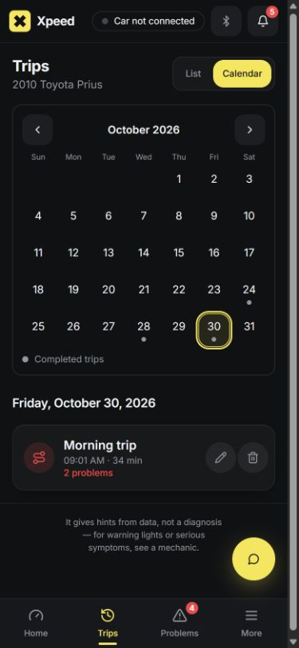

# Correções da revisão do Xpeed — 30/10/2026

As 14 ocorrências da revisão foram tratadas no código local. Este pacote não foi publicado, enviado ao GitHub nem aplicado ao banco de produção.

| # | Ocorrência | Correção | Verificação |
|---|---|---|---|
| 1 | Problemas podiam ficar ausentes após a viagem ser salva | Fila de reconciliação criada na mesma transação da viagem, com confirmação por versão, repetição após falhas e adiamento de trabalhos que falham. Inclui códigos e avisos da análise salva. Reconhecer um recibo existente também tenta reparar problemas pendentes. | API com falha de ocorrência seguida de recuperação; SQL com confirmação obsoleta, isolamento e adiamento. |
| 2 | MPG, L/100km e L/h podiam ser misturados | Identidades diferentes por medida; interpretação separada dos resumos antigos; unidades visíveis no seletor de tendências. MPG imperial também tem identidade própria. | Regressão de tendências com MPG e L/h na mesma série histórica. |
| 3 | Leituras do carro conectado recebiam o nome do carro selecionado | Identidade pelo VIN, aviso quando a seleção diverge, painel e personalização vinculados ao carro conectado. A notificação de viagem também usa a identidade conectada. Leituras sem identidade confirmada não recebem outro nome. | Tela Live com carro A conectado e B selecionado; alerta preservado para A durante a seleção de B. |
| 4 | Leitura ausente ou parcial podia aparecer como “All good” | Leitura completa preservada nas cópias locais, checkpoints, gravação direta, reprocessamento e relatório compartilhado. Falhas pendentes entram nos problemas da viagem. Ausência de problemas salvos não é apresentada como nova inspeção. | Regressões de leitura parcial e código pendente; SQL do relatório compartilhado. |
| 5 | Viagem excluída podia ser recriada por uma cópia pendente | Marcador permanente de exclusão, bloqueio no banco e nos checkpoints, descarte da cópia pendente reconhecida como excluída. Falha de limpeza não autoriza recriação. | SQL de exclusão e tentativa de reinserção; recibo local reconhecendo exclusão; cascata de exclusão do carro. |
| 6 | Repetir um abastecimento após resposta perdida duplicava o gasto | Identificador estável por tentativa de formulário e objeto imutável no servidor. Repetição idêntica retorna o registro existente; detalhes diferentes com o mesmo identificador retornam conflito. | Resposta perdida, requisições concorrentes e conflito de conteúdo. |
| 7 | Navegação interna descartava configurações pendentes | Bloqueio real de navegação com opção de ficar ou descartar, além da proteção contra recarga e atualização do aplicativo. | Teste com roteador real e conferência no navegador: cancelar, salvar e receber confirmação. |
| 8 | Distância com pouca cobertura era extrapolada para toda a viagem | Mesma regra de cobertura para distância, consumo e custo. Sem cobertura suficiente, o número fica indisponível. Registros antigos sem prova de cobertura aguardam reprocessamento a partir do original. | Regressão com apenas 10 segundos de velocidade numa viagem de uma hora. |
| 9 | Alertas não observavam sensores durante a viagem | Monitor de limites e duração sustentada, com interrupção da evidência após lacunas ou leituras ausentes. Alertas ficam na central do aplicativo e no carro correto, com controle de repetição por viagem. | Sequência normal/aviso/crítico, leitura ausente, lacuna e troca de carro selecionado. |
| 10 | Sino, contador e Problems podiam discordar | Uma consulta compartilhada e uma invalidação para os consumidores. A atualização por tempo, reconexão ou evento do banco atualiza a mesma fonte. | Consumidores simultâneos, uma consulta inicial e atualização conjunta. |
| 11 | Histórico e contexto eram carregados repetidamente | Cache compartilhado de resumos para Home, combustível e tendências; retirada da análise extensa dessas consultas; páginas de 20 viagens e contagens do calendário calculadas no banco; retirada do contexto de chat que era montado no cliente e ignorado no servidor. | SQL com 300 viagens, acesso à página 15 e dia no fuso escolhido; testes de histórico, chat e atualização das páginas. |
| 12 | Datas não respeitavam o fuso escolhido | Datas de problemas e formulário de abastecimento seguem o fuso das configurações. Datas inválidas e horários inexistentes na mudança para horário de verão são recusados. | Conversão entre fusos, mudança de dia, horário inexistente e hora repetida. |
| 13 | Regras de uma geração eram aplicadas a outros carros/anos | Intervalos explícitos para F-150, WRX e Civic; modelos Prius C/V não recebem regras do Prius comum por prefixo. Fora da correspondência, são usadas regras genéricas. Versão de processamento atualizada. | Casos por modelo, ano e alternativa genérica; integridade das referências de regras no banco. |
| 14 | Traduções ausentes e bytes inválidos | Traduções de repetição e mensagens novas nos três idiomas; arquivos de interface convertidos para UTF-8 válido. Retirado também o aviso duplicado de Settings, que já aparecia no rodapé. | Igualdade das chaves de idioma, validação de UTF-8 e conferência visual. |

## Validação

Os resultados finais dos comandos estão em `validacao.txt`. As verificações SQL usam PostgreSQL em memória com dados sintéticos, sem credenciais nem acesso à produção. O teste visual usa a cópia local com Supabase e adaptador simulados, em largura de 390 pixels.

## Publicação futura

Aplicar `supabase/migrations/20261030160000_durable_issue_jobs_and_deletions.sql` antes de publicar os endpoints e as telas deste pacote. Ela cria a fila durável, os marcadores de exclusão e as funções de paginação/calendário, e acrescenta ao relatório compartilhado somente os metadados de inspeção necessários.

Os trabalhos pendentes são consumidos em lotes quando o aplicativo está aberto, ao recuperar conexão e em verificações periódicas. Continuam no banco quando o aplicativo fecha. O histórico e os alertas antigos podem exigir reprocessamento do CSV original; não são inventadas leituras ausentes.

Não foi instalado nem testado um APK em um Android físico nesta revisão. O monitor de sensores deste pacote alimenta a central de notificações do aplicativo; não acrescenta um novo alerta sonoro do Android. A compatibilidade física do adaptador e o comportamento do Android em segundo plano continuam dependendo de teste no aparelho.
